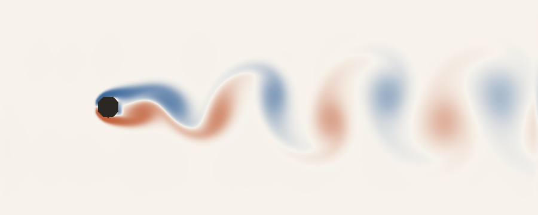
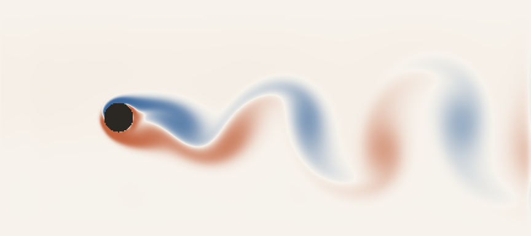
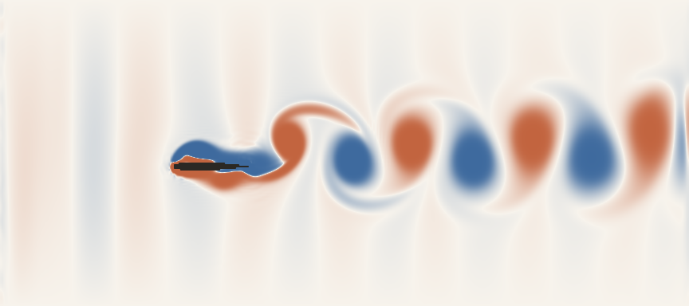
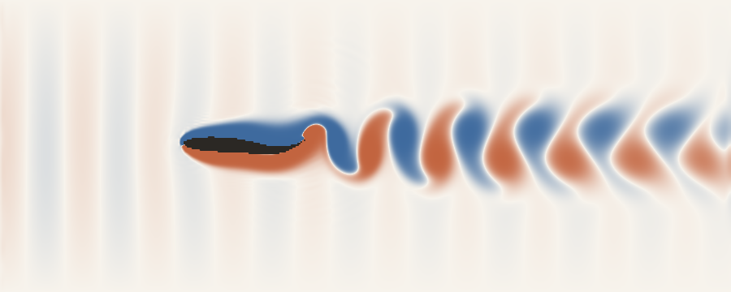
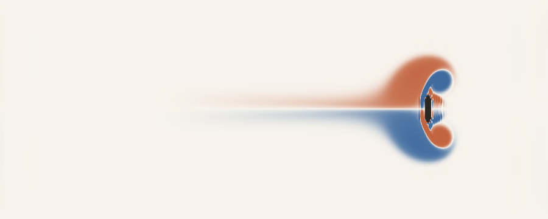
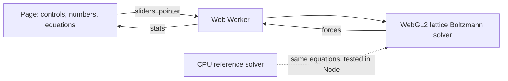

# Fluid Gallery

Live 2D simulations of things moving through water, solved in your browser on the GPU with the lattice Boltzmann method and checked against published data.

**[Open the gallery →](https://amalmehta.github.io/FluidGallery/)**

| | |
|---|---|
|  **Cylinder Wake**: the von Kármán vortex street. *Checked* against St and drag at Re = 100. |  **Spinning Cylinder**: Magnus lift, shedding that stops at high spin. *Checked* against published trends. |
|  **Flapping Wing**: heave faster and drag turns into thrust. *Qualitative.* |  **Swimming Fish**: carangiform kinematics from real fish data. *Qualitative.* |
|  **Draw and Drag**: sketch any shape and drag it through the water. | Blue = water spinning clockwise, terracotta = counter-clockwise. Every image here is a real run of the solver. |

- [How to run it, use it and test it](docs/INSTRUCTIONS.md)
- [Validation: every number checked, with the commands](docs/VALIDATION.md)
- [System design, decisions and limits](docs/SYSTEM-DESIGN.md)
- [What's where](docs/FILE-STRUCTURE.md)
- [Prompt log](docs/PROMPTS.md)

2D and low Reynolds number (20–800): the mechanisms carry over to real drones and fish, the exact numbers don't. Each sim states its own limits.
