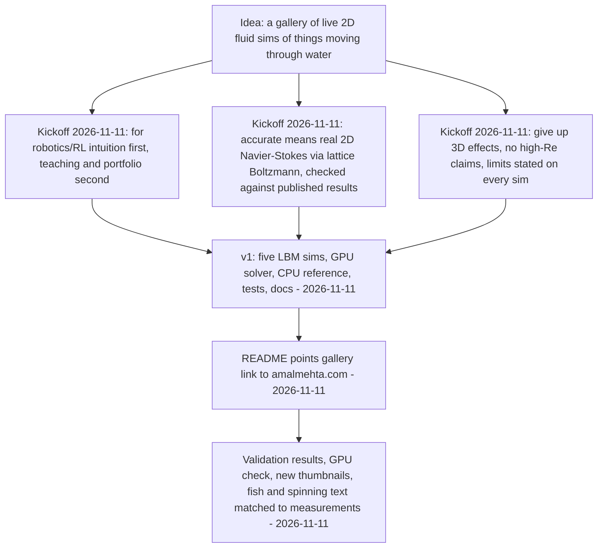
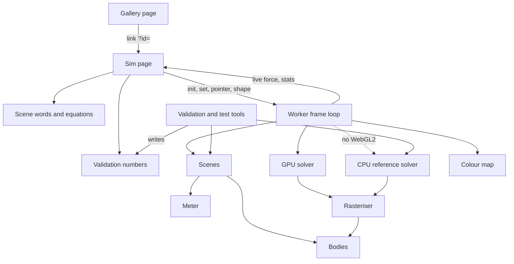
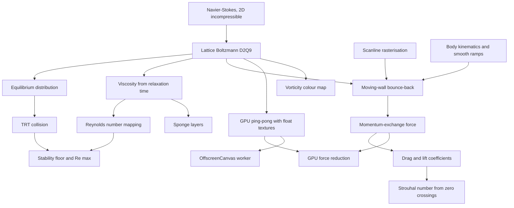

<!-- ProjectForge explainer at 54383b5 -->
# How fluid dynamics simulator around various things in motion, with accurate equations was built

Fluid Gallery is a static website with five live 2D simulations of bodies in water: a still cylinder, a spinning cylinder, a flapping wing, a swimming fish and a shape you draw and drag. Its author built it first to sharpen their own intuition for robotics and reinforcement learning (drones, swimmers, flappers). It also works for teaching and as a portfolio piece. The idea that makes it work: one lattice Boltzmann solver runs as WebGL2 shaders in the visitor's browser, fast enough to watch vortices form in seconds. A plain-JavaScript copy of the same solver runs in Node, so the physics can be tested and compared with published results.

## Build history

The history has only three commits, all on 2026-11-11, so each commit is its own milestone.

- **Kickoff (2026-11-11):** set the audience (the author, for robotics/RL), defined "accurate" as 2D lattice Boltzmann checked against the literature, and gave up 3D effects such as wingtip vortices and 3D wake breakdown.
- **v1 (2026-11-11):** five live lattice Boltzmann sims with a GPU solver, a CPU reference solver, tests and docs.
- **README link (2026-11-11):** the README's gallery link now points to the amalmehta.com custom domain.
- **Validation (2026-11-11):** added the validation results (`docs/VALIDATION.md`, `src/validation.js`), the GPU-vs-CPU check (`docs/gpu-check.json`) and refreshed thumbnails. Rewrote the fish and spinning-cylinder text to match what was measured. Three checks failed and the site says so: shedding at α = 2 dropped 9-fold instead of 10-fold, the fish never reached net thrust, and the GPU mean force differed from the CPU by 1.12% on the foil.

## Code map

| Part | File | What it does |
|---|---|---|
| Gallery page | `src/ui/gallery.js` | Builds the five cards from `SCENES` and `CONTENT` and shows the cylinder's validation error from `VALIDATION`. |
| Sim page | `src/ui/sim.js` | Lays out one sim, typesets its equations with KaTeX, runs the sliders, starts the worker, draws the force arrow and chart. |
| Shared UI | `src/ui/common.js`, `src/ui/boot.js` | Header, icons, settings, feedback tab, prefs in `localStorage`; `boot.js` sets the theme before first paint. |
| Scene words and equations | `src/content.js` | Text for each scene: what you see, things to try, TeX equations with symbols, limits, references. |
| Validation numbers | `src/validation.js` | Generated by `tools/validate.mjs`; the measured numbers the app shows under "How it was checked". |
| Worker frame loop | `src/worker.js` | Owns the simulation off the main thread: picks GPU or CPU, steps per frame, reads forces, draws, restarts if unstable. |
| Scenes | `src/lbm/scenes.js` | The five setups: grid size, inflow speed, viscosity from Re, body, sliders, stability floor; `advance()` runs one step. |
| Bodies | `src/lbm/bodies.js` | Shapes as polygons, with the wall velocity at any point and smooth start-up. |
| Rasteriser | `src/lbm/raster.js` | Turns a body polygon into solid cells and wall velocities, and reports cells the body uncovers. |
| CPU reference solver | `src/lbm/solver.js` | D2Q9 TRT lattice Boltzmann in plain JS (`Lattice`); runs in the browser fallback and in Node. |
| GPU solver | `src/lbm/gpu.js` | The same method as WebGL2 fragment shaders (`GpuLattice`), plus force reduction and vorticity rendering. |
| Meter | `src/lbm/measure.js` | Turns raw force into drag and lift coefficients, running means, and the Strouhal number. |
| Colour map | `src/lbm/render.js` | Palettes and vorticity-to-colour mapping; the CPU drawing path. |
| Validation and test tools | `tools/validate.mjs`, `tools/validate-case.mjs`, `tests/solver.test.mjs`, `tests/gpu-check.html`, `tests/stability.html` | Long physics runs against the literature, fast unit tests, GPU-vs-CPU and stability checks in the browser. |
| Thumbnails | `tools/thumbs.mjs`, `tools/png.mjs` | Renders the gallery images from real CPU runs. |

## Concepts

**Navier–Stokes, 2D incompressible.** These are the equations of motion for a viscous fluid: momentum changes because of pressure and viscosity, and the fluid neither appears nor vanishes. This is what "accurate" means in this project. The code never solves these equations directly; the lattice Boltzmann method reproduces them when speeds are well below the lattice sound speed. The sims run at Mach ≈ 0.1–0.2, so small sound waves exist that a real liquid would not show (`docs/SYSTEM-DESIGN.md`, "Known limits").

**Lattice Boltzmann, D2Q9.** Space is a grid of cells. Each cell holds nine numbers $f_i$, one for each of nine directions $\mathbf{c}_i$ (rest, four sides, four diagonals). Each $f_i$ is the amount of fluid moving that way. Every time step has two parts. *Collision* nudges each cell's $f_i$ toward a local equilibrium. *Streaming* moves each $f_i$ one cell along its direction. Density and velocity are sums: $\rho=\sum_i f_i$, $\rho\mathbf{u}=\sum_i f_i\mathbf{c}_i$. The project uses it because each cell only touches its neighbours, so every cell can be updated in parallel on a GPU. Everything is in lattice units: one cell is one unit of length and one step is one unit of time. Directions, weights $w_i$ and opposites are `CX`, `CY`, `W`, `OPP` in `src/lbm/solver.js`; the shader copies are `C`, `WT`, `OPPI` in `src/lbm/gpu.js`.

$$f_i(\mathbf{x}+\mathbf{c}_i,\,t+1)=f_i^{*}(\mathbf{x},t)$$

**Equilibrium distribution.** This is the value each $f_i$ would have in a fluid at rest relative to its local velocity $\mathbf{u}$. Collision relaxes toward it. It is also used to set the inflow and to refill cells a body leaves. `feq` in `src/lbm/solver.js`. The GPU version `feqd` returns it minus $w_i$; see the GPU concept below.

$$f_i^{eq}=w_i\,\rho\left(1+3\,\mathbf{c}_i\!\cdot\!\mathbf{u}+\tfrac92(\mathbf{c}_i\!\cdot\!\mathbf{u})^2-\tfrac32|\mathbf{u}|^2\right)$$

**TRT collision (two relaxation times).** Each direction $i$ and its opposite $\bar i$ form a pair. The even part $f_i^+=\tfrac12(f_i+f_{\bar i})$ and the odd part $f_i^-=\tfrac12(f_i-f_{\bar i})$ relax at different rates $\omega^\pm=1/\tau^\pm$. $\tau^+$ sets the viscosity. $\tau^-$ is tied to it by the "magic" product $\Lambda=(\tau^+-\tfrac12)(\tau^--\tfrac12)=\tfrac14$, the most stable choice (Ginzburg et al. 2008). The project needs it because the simpler single-rate (BGK) collision is less stable at the low viscosities these Reynolds numbers need. The cost: with $\Lambda=1/4$, the effective wall position shifts slightly with viscosity. Walls sit exactly halfway between cells only at $\Lambda=3/16$. The code computes `omMx` as $1/(\tfrac12+\tfrac14/(\tau-\tfrac12))$ in `setViscosity` (`src/lbm/solver.js`) and inline in `STEP_FS` (`src/lbm/gpu.js`).

$$f_i^{*}=f_i-\omega^+\left(f_i^+-f_i^{eq+}\right)-\omega^-\left(f_i^--f_i^{eq-}\right)$$

**Viscosity from relaxation time.** In lattice units the kinematic viscosity (how quickly the fluid smooths out velocity differences) is fixed by $\tau^+$. Changing viscosity is therefore just changing one number, which is why the Re slider takes effect with no restart. `setViscosity` in `src/lbm/solver.js`; `GpuLattice.setViscosity` stores `nu`, which becomes the `uNu` uniform in `src/lbm/gpu.js`.

$$\nu=\frac{\tau-\tfrac12}{3}$$

**Reynolds number mapping.** The Reynolds number $Re=UD/\nu$ is the ratio of inertia to viscosity. It decides whether a wake is steady, sheds vortices, or goes turbulent. Each scene fixes the inflow speed $U$ and body size $D$ in cells, and sets $\nu=UD/Re$ from the slider. Example: the cylinder at Balanced quality has $D=24$ cells and $U=0.1$, so Re = 100 gives $\nu=0.024$ and $\tau=0.572$. `build` and `set` per scene in `src/lbm/scenes.js`.

**Stability floor and Re max.** Lattice Boltzmann blows up when $\tau$ gets too close to ½. Each scene has a measured floor `tauMin` (0.512 for the fixed cylinder, 0.527–0.53 for moving bodies), found with `tests/stability.html`. Combining the two formulas above gives the highest Reynolds number a grid can run. The slider maximum is clamped to this number, so the slider can't reach settings that blow up. `paramMax` and `clampParams` in `src/lbm/scenes.js`. The slider note ("Up to … at … quality") is in `renderSliders` in `src/ui/sim.js`. A unit test checks the rule in `tests/solver.test.mjs`.

$$Re_{max}=\frac{3\,U D}{\tau_{min}-\tfrac12}$$

**Sponge layers.** Over the first and last $w=\min(40,\operatorname{round}(n_x/15))$ columns, viscosity rises quadratically to 0.1. Without this, the hard equilibrium inlet grows an odd-even "checkerboard" instability. The design doc records the cylinder at Re = 300 blowing up after about 1,650 CPU steps. `spongeNu` and `spongeWidth` in `src/lbm/solver.js`; the same formula is inlined in `STEP_FS` in `src/lbm/gpu.js`. In `advance()` the draggable shape is kept out of the sponges (`src/lbm/scenes.js`).

$$\nu(x)=\nu+\big(\max(\nu,0.1)-\nu\big)\,s^2,\qquad s=\frac{w-d}{w},\; d=\text{distance to nearest end}<w$$

**Scanline rasterisation.** A body is a polygon. For each grid row, the rasteriser finds where polygon edges cross that row and fills the cells between pairs of crossings. Cells inside become solid and get the body's wall velocity. Cells that were solid and are now outside are "uncovered": the body has just left them, and they must be refilled. Only the bounding box of the old and new positions is visited. `rasterize` in `src/lbm/raster.js`. The refill uses the equilibrium at the wall velocity and the mean density of fluid neighbours: `applyBody` in `src/lbm/solver.js`, and the `fresh` branch of `STEP_FS` in `src/lbm/gpu.js`.

**Moving-wall bounce-back (Ladd).** When a population would stream into a solid cell, it is sent back the way it came instead. This is what makes a wall with no slip. If the wall moves, a correction adds the wall's momentum ($c_s^2=1/3$ gives the factor 6). Walls follow the cell edges as staircases, which is first-order accurate in wall position. `_bounce` in `src/lbm/solver.js`; the `sb.r > .5` branch in `STEP_FS`, `src/lbm/gpu.js`.

$$f_{\bar i}(\mathbf{x},t+1)=f_i^{*}(\mathbf{x},t)-6\,w_i\,\rho\,(\mathbf{c}_i\!\cdot\!\mathbf{u}_w)$$

**Momentum-exchange force.** Every bounce changes the momentum of the population that bounced. Summing those changes over every link between fluid and wall gives the force on the body, with no surface integral needed. The project uses the Galilean-corrected form (Wen et al. 2014), which adds the $\mathbf{u}_w$ term for moving walls. Momentum carried by cells the body covers or uncovers is not added, so forces on moving bodies spike step to step; the averages are what the UI shows. `_bounce` accumulates `_fx`, `_fy` in `src/lbm/solver.js`; the `force` sum in `STEP_FS` writes it to a fourth render target in `src/lbm/gpu.js`.

$$\mathbf{F}=\sum_{\text{wall links}}\Big[\mathbf{c}_i\,(f_i^{*}+f_{\bar i})-\mathbf{u}_w\,(f_i^{*}-f_{\bar i})\Big]$$

**Drag and lift coefficients.** Raw force depends on grid size and speed. Dividing by $\tfrac12\rho U^2 D$ makes it comparable with published numbers. For the fish, drag is net streamwise force; a negative value means thrust. `Meter.push` in `src/lbm/measure.js`.

$$C_D=\frac{F_x}{\tfrac12\rho U^2 D},\qquad C_L=\frac{F_y}{\tfrac12\rho U^2 D}$$

**Strouhal number from zero crossings.** $St=fD/U$ is a vortex-shedding frequency without units. The well-known check value is 0.165 for a cylinder at Re = 100. `strouhal` estimates the lift signal's amplitude from its variance ($\sqrt{2\,\mathrm{var}}$, the amplitude of an equivalent sine). It smooths the signal with a 15-sample moving average. It counts upward crossings of the mean, armed only after the signal dips below −20% of the amplitude (hysteresis, so noise can't make false crossings). The period is the mean spacing of the crossings. It returns no period if the swing is under 0.02 or there are fewer than 3 crossings. `src/lbm/measure.js`; tested to within 1% in `tests/solver.test.mjs`.

**Body kinematics and smooth ramps.** Each body supplies its outline and a wall velocity at any point. The spinning cylinder's surface moves at $\alpha U$ (Magnus lift). The foil is a NACA 0012 airfoil that heaves and pitches. The fish follows a published midline wave (Khalid et al.):

$$y(s,t)=L\,A(s)\sin\!\left(2\pi\left(\tfrac{s}{\lambda}-ft\right)\right),\quad A(s)=0.02-0.0825s+0.1625s^2$$

Amplitudes ease in with $r=\tfrac12(1-\cos(\pi t/T))$ over the first cycle. Spin changes by at most 0.002 per step. The dragged shape accelerates by at most 0.002 cells/step². The reason: impulsive starts sent density waves of 5–13% around the domain (`docs/SYSTEM-DESIGN.md`). Phase is accumulated, so changing frequency mid-run doesn't make the body jump. `ramp`, `cylinder`, `flappingFoil`, `fish`, `dragShape` in `src/lbm/bodies.js`.

**GPU ping-pong with float textures.** WebGL2 has no general compute, so each step is one full-screen fragment-shader draw with one pixel per cell. Shaders read the old state from three RGBA32F textures (`A = f0..f3`, `B = f4..f7`, `C = f8, ρ, ux, uy`). They write the new state to a second set, using four render targets at once (the fourth holds per-cell force). The two sets swap every step. The GPU pulls from neighbours, where the CPU pushes to them; the result is the same. Populations are stored as $f_i-w_i$ because float32 keeps about three more significant digits of the small changes that carry the flow. The design doc records this cut the GPU-vs-CPU difference 10×. `GpuLattice` and `STEP_FS` in `src/lbm/gpu.js`. The design doc gives speeds of about 150 million cell updates/s on the GPU against about 13 million on the CPU.

**GPU force reduction.** Reading the whole force texture back every step would stall the GPU. Instead `_reduceForce` sums 4×4 blocks of the region around the body, pass after pass, until one pixel remains. It writes that pixel into a 256-wide history row. `readForces` reads the whole row once per frame, so every step's force reaches the meter in one transfer. `REDUCE_FS`, `_reduceForce`, `readForces` in `src/lbm/gpu.js`.

**Vorticity colour map.** Vorticity is the local spin of the fluid, $\omega=\partial u_y/\partial x-\partial u_x/\partial y$, computed with central differences. It is squashed with $\tanh(\omega\cdot\text{scale})$, coloured blue (clockwise) or terracotta (counter-clockwise), and anything below 6% of the scale is hidden. That dead zone hides the faint bands left by sound waves bouncing between the walls. `VORT_FS` and `SHOW_FS` in `src/lbm/gpu.js`; `renderField`, `vortScale`, `PALETTES` in `src/lbm/render.js`.

**OffscreenCanvas worker.** The page hands its canvas to a module Web Worker with `transferControlToOffscreen`. The worker's thread then owns the WebGL2 context and the whole frame loop, so sliders and text stay responsive. The worker adapts how many steps it runs per frame (×1.15 when a frame takes under 8 ms, ×0.8 when over 14 ms) to hold the display rate. `start()` in `src/ui/sim.js`; `setup` and `frame` in `src/worker.js`.

## One input, start to finish

The input: a visitor opens `sim.html?id=cylinder` at Balanced quality and reads the mean-drag tile.

1. **Page load.** `sim.html` runs `src/ui/boot.js` (theme before first paint), then the module `src/ui/sim.js`. It calls `loadPrefs` and `applyPrefs` (`src/ui/common.js`), reads `id` from the query string, and looks it up with `byId` (`src/lbm/scenes.js`). An unknown id would show the "doesn't exist" panel and never touch the solver.
2. **Page built.** `start()` in `src/ui/sim.js` gets `params = clampParams(scene, defaults(scene), q)`, giving `{ Re: 100 }`. It writes the layout and typesets the scene's equations from `CONTENT` (`src/content.js`) with KaTeX through `tex` and `eqBlock`. `renderSliders` sets the Re slider's maximum from `paramMax`.
3. **Worker started.** `start()` calls `field.transferControlToOffscreen()`, creates `new Worker('src/worker.js', { type: 'module' })`, and posts `{ type: 'init', canvas, scene: 'cylinder', params, quality, theme, contrast, w, h }`.
4. **Backend chosen.** `self.onmessage` → `setup` in `src/worker.js` asks for a `webgl2` context and checks `GpuLattice.supported` (needs `EXT_color_buffer_float`). On success the backend is `'gpu'`. Otherwise it falls back to the CPU `Lattice` at quality ≤ 0.75 and posts a notice.
5. **Scene built.** `build()` calls the cylinder's `build` in `src/lbm/scenes.js`. `geom(1)` gives $D=24$ and $U=0.1$, so the grid is 600 × 240 with the centre at (120, 120) and $\nu=0.1\cdot24/100=0.024$. `make` constructs a `GpuLattice` (`src/lbm/gpu.js`). The constructor compiles four shader programs and allocates two sets of three state textures, a force texture, a body texture, reduction textures and the history row. `initEquilibrium` uploads uniform flow at $U$, plus a small sideways `nudge` just behind the cylinder so shedding starts within a few cycles. `cylinder()` (`src/lbm/bodies.js`) makes a 96-sided polygon. The `Meter` (`src/lbm/measure.js`) gets an averaging window of round(6·24 / (0.165·0.1)) = 8,727 steps, about six shedding periods.
6. **First frame.** `frame()` in `src/worker.js` wants `scene.pace × q` = 16 steps. It runs `min(16, stepsPerFrame)`; `stepsPerFrame` starts at 8 and adapts. Each step calls `advance(sc)` in `src/lbm/scenes.js`.
7. **Body placed once.** In `advance`, the cylinder neither moves nor is steered. On the first call (`!s._placed`), `lat.applyBody(body)` runs `rasterize` (`src/lbm/raster.js`) to mark solid cells. `GpuLattice.applyBody` uploads only that box into `bodyTex` and records `_forceBox`, the region to sum force over.
8. **One lattice step on the GPU.** `GpuLattice.step` draws `STEP_FS` into the other state set. Each fluid pixel pulls $f_i$ from its upstream neighbours. Top and bottom rows mirror (free-slip walls), the left column is reset to the equilibrium inflow, and the right column copies its neighbour (outflow). Links into the cylinder bounce back, and their momentum change is added to `force`. The pixel then computes $\rho$ and $\mathbf{u}$, its sponge viscosity and $\tau$, and applies TRT collision. It writes three state targets plus `oF`. `_reduceForce` then collapses `oF` over `_forceBox` into one pixel of the history row.
9. **Forces to the meter.** After the batch, `frame()` sees `sc.lat.async` and calls `readForces()`, one `readPixels` of the history row. Each `[fx, fy]` goes to `Meter.push`, which stores $C_D=F_x/(\tfrac12U^2D)$ and $C_L$ in a ring buffer and averages every 20 samples for the chart.
10. **Draw.** `draw()` calls `GpuLattice.render`. `VORT_FS` computes vorticity into a half-float texture, and `SHOW_FS` maps it through tanh, the dead zone and the palette from `PALETTES` (`src/lbm/render.js`) onto the visible canvas. Every 500 steps, `hasNaN` samples the density. If the flow has blown up, the worker rebuilds the scene and posts a notice.
11. **Numbers out.** Every frame `postLive` sends the last 50 samples' mean $C_D, C_L$ for the force arrow. About every 160 ms, `postStats` sends `Meter.summary()`: means over the window, the lift amplitude, and $St$ from `strouhal`.
12. **Tile shown.** `onStats` in `src/ui/sim.js` marks the averages as settling until three quarters of the window (about 6,545 steps) has passed since the last change; until then tiles show "…". `tiles` builds the cylinder tiles. Because Re is exactly 100, the drag tile adds `refLine(st.cd, 1.33, 0.1)`, which reads "within" or "off by" a percentage. For scale: the CPU reference measured $C_D=1.478$ at these settings, 11.2% above 1.33 (`docs/VALIDATION.md`). That is past the tile's 10% "within" mark but inside the 12% pass mark in `tools/validate.mjs`. Part of the gap is the 10% channel blockage.
13. **If the visitor then moves the slider to Re = 200.** The `input` handler in `src/ui/sim.js` updates the label and posts `{ type: 'set', key: 'Re', value: 200 }`. The worker calls the scene's `set`, which calls `setViscosity(0.1·24/200)`. The next `step` passes the new `uNu` uniform, so the flow keeps running with no restart. `settleFrom` resets, so the averages show "…" again until the new window fills.

## Where this came from

Written from the spec, the decisions, the git history and the code as of commit 54383b5 (2026-11-11).
