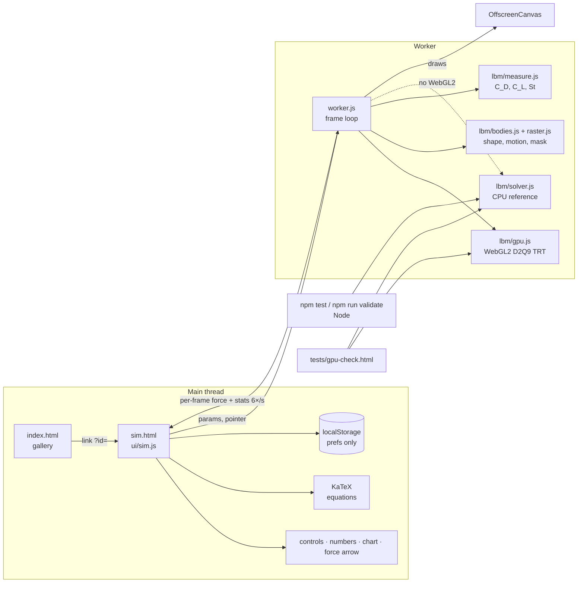

# System design: Fluid Gallery

A static website with five 2D fluid simulations of things in motion. Each one is solved live in the browser with the lattice Boltzmann method and checked against published results wherever such results exist.

## Who it's for and the one result

- **For:** a robotics/RL research engineer who wants a feel for how bodies that move through fluid (drones, swimmers, flappers) shed vortices and make force, and wants to be able to show others.
- **The one result:** open a sim, change one knob (Re, spin, flapping rate), and see within seconds how the wake and the force change, with numbers you can trust within stated limits.

## Architecture

| Piece | Job | Interface |
|---|---|---|
| `src/lbm/solver.js` | CPU reference: D2Q9 lattice Boltzmann, TRT collision, push streaming, moving-wall bounce-back, momentum-exchange force, inlet / outlet / free-slip walls, sponge layers, optional periodic | `new Lattice({nx,ny,nu,U})`, `.step()`, `.applyBody(body)`, `.fx/.fy` |
| `src/lbm/gpu.js` | The same method as fragment shaders: 3 RGBA32F textures of post-collision populations (stored as offsets from rest), pull streaming, a 4th target for per-link forces, reduced on the GPU to one pixel per step and read back once per frame. Also renders vorticity. | same interface as `Lattice`, plus `readForces()`, `render()` |
| `src/lbm/raster.js` | Polygon → solid cells and wall velocities, visiting only the region that changed; reports cells the body uncovers | `rasterize(body, grid, onUncover)` |
| `src/lbm/bodies.js` | Shapes as polygons plus wall velocity at any point; smooth start ramps | `{update(t), polygon, velocity(x,y), refLength, moving}` |
| `src/lbm/scenes.js` | The five scenes: grid, U, ν from Re, body factory, sliders, stability floor τ_min, pace | `build(params, quality, make)`, `advance(s)`, `paramMax()` |
| `src/lbm/measure.js` | Coefficients, running means, Strouhal number from lift zero-crossings | `new Meter({U, refLength})`, `.push(fx,fy)`, `.summary()` |
| `src/worker.js` | Owns the sim; picks GPU or CPU; steps per frame from the scene pace (adaptive at Max); restarts with a notice if the flow goes unstable | messages `init/set/reset/run/speed/theme/quality/resize/pointer/shape` |
| `src/ui/*` | Gallery, sim page, settings sheet, feedback tab, opening animation, chart | DOM only, no physics |
| `src/content.js` | Words per scene: what you see, things to try, equations with symbols, limits, references | data |

**Why the GPU, with the CPU solver as reference.** The CPU solver measured ~13 million cell updates/s on this Mac (~90 steps/s at 600×240), so one shedding cycle took ~15 s to appear. That's too slow to build intuition. The WebGL2 solver measured ~150 million/s (~1,000 steps/s) on the same Mac's integrated GPU. The CPU solver stays, because it runs in Node: `npm test` and `npm run validate` check the physics on it, and `tests/gpu-check.html` checks that the GPU gives the same flow. Cost: two implementations of one method to keep in sync, guarded by that test. **Change at:** 3D, or grids above ~500k cells. Then move to WebGPU compute behind the same interface.

## Main flows

1. **Open a sim:** `sim.html?id=cylinder` reads prefs, renders the text and equations, transfers the canvas to the worker, and sends `init`. The worker builds the scene on the GPU and starts the loop: run the scene's steps for this frame, read the forces back, draw.
2. **Change a slider:** the value shows at once on the main thread, and a `set` message goes to the worker, which applies it before the next step. ν changes in place with no restart. The spin ratio eases toward its new value (≤ 0.002 per step) so the wall never jerks. Flapping frequency changes keep phase, so the body doesn't jump.
3. **Draw and drag:** pointer positions go to the worker in grid coordinates. The shape accelerates toward them (≤ 0.002 cells/step², ≤ 0.08 cells/step) and slows to a stop. A finished stroke becomes a new polygon; the old one's cells are refilled.
4. **Numbers:** the worker posts the force for the arrow every frame, and averages, Strouhal number and the chart history about 6 times a second. Averages show "…" until about ¾ of an averaging window has passed since the last change.

## Data

The site has no server and no accounts. The only thing stored is display preferences (theme, quality, contrast, force arrow, motion) in `localStorage` in the viewer's own browser. They can be cleared from Settings. Feedback opens a prefilled GitHub issue form on github.com, and nothing is sent unless the visitor submits it there.

## Key decisions and trade-offs

- **2D only.** There are no wingtip vortices or 3D wake breakdown, and 2D wakes are more regular than real ones. This is stated on every sim.
- **Low Reynolds number (≈ 20–800).** Real drones and fish run at 10⁴–10⁶. The *mechanisms* carry over (vortex shedding, Magnus lift, thrust wakes); the *numbers* do not.
- **TRT instead of BGK collision.** Odd and even parts of each population relax at different rates, tied by the "magic" product Λ = 1/4, the choice with the best stability (Ginzburg, Verhaeghe & d'Humières 2008). Bounce-back walls sit exactly halfway between cells only at Λ = 3/16. At 1/4 the effective wall shifts slightly with viscosity, a small error that is part of what the validation measures.
- **Sponge layers.** The first and last ~40 columns have viscosity rising smoothly to ν = 0.1. Without them, the hard equilibrium inlet grows an odd-even ("checkerboard") instability at low viscosity. This was measured: the cylinder at Re = 300 blew up after ~1,650 steps on the CPU and ~950 on the GPU, which seeds it larger. Bodies sit well inside the sponges.
- **Stability floors.** Each scene has a minimum relaxation time τ_min (0.512–0.53), measured with `tests/stability.html` at the slider extremes. The highest Reynolds number a quality setting can reach follows from it: Re_max = 3 U D / (τ_min − ½). The UI shows this limit instead of letting the sim blow up.
- **GPU state as offsets from rest.** The GPU stores f_i − w_i in float32. That cut the GPU-vs-CPU velocity difference 10× (to ~5 × 10⁻⁶ U).
- **Staircase boundaries (simple bounce-back).** First-order accurate in where the wall sits. Fine at D ≥ 20 cells for the checks we run. Interpolated bounce-back would be the next step.
- **Moving bodies:** Ladd's moving-wall bounce-back. Cells the body uncovers are refilled at equilibrium with the wall velocity. The force uses the Galilean-corrected momentum exchange (Wen et al. 2014). The momentum carried by cells the body covers or uncovers is *not* added to the force, which gives small force spikes on moving bodies (stated).
- **Fish wall velocity** uses the small-amplitude form (lateral midline velocity only).
- **Blockage:** domain height = 10 D for the cylinder (8 D for the spinning one). That raises Cd and St by a few percent compared with an unbounded flow (stated next to the check).

- **Smooth starts.** Moving bodies ease in over their first cycle, spin eases toward its target, and the dragged shape has inertia. Impulsive starts sent 5–13% density waves around the domain and pushed marginal settings over the edge.
- **Colour dead zone.** The colour map ignores |vorticity| below 6% of its scale. The weakly compressible method lets sound waves bounce between the walls, and they carry tiny vorticity that otherwise showed as faint bands. Real vortices are far above this threshold.
- **Self-hosted fonts and KaTeX.** About 1 MB in the repo instead of CDN requests, so no third party sees visitors.

## Testing

- `npm test` (about a minute): rest stays at rest; shear-wave decay matches the set viscosity within 2% (a direct test of the collision); mass is conserved to 1e-10 around a body; the rasteriser gets a circle's area within 3% and frees exactly the cells a moving body leaves; the Strouhal detector finds a known period within 1%; wall velocities match the finite-difference motion; slider limits keep τ above each floor; every scene runs its defaults on the CPU.
- `npm run validate` (10–20 min): the physics checks against literature, with thresholds fixed in the spec before running. Results go to `docs/VALIDATION.md` and into the app (`src/validation.js`).
- `tests/gpu-check.html`: GPU vs CPU on every scene. `tests/stability.html`: every scene at its slider extremes at every quality, on the GPU.
- By hand in the browser: every sim opened and its controls used, in light and dark mode, and at phone width. See the manual review checklist in the spec.

## Threat model

It's a static site with no auth, no user data and no backend. Here are the ways someone could cause trouble, and the answer to each:
- **Query string `?id=`** is looked up in a fixed table. Unknown ids show the gallery link, and the value is never inserted as HTML.
- **Prefs from localStorage** are parsed and checked against allowed values. Bad values fall back to defaults.
- **Third parties:** none at runtime. Fonts and KaTeX are served from the repo itself, so no CDN sees visitors.
- **Feedback** goes through GitHub's own issue form. The URL carries only the sim id.
- Hosted on GitHub Pages over HTTPS only.

## Known limits

2D; Re ≤ ~800 (and lower at Fast quality); staircase walls; prescribed motion (bodies don't react to forces); weak compressibility (Mach ≈ 0.1–0.2) means pressure waves exist that a real liquid wouldn't show; forces on moving bodies are noisy step to step (averages are reliable); Strouhal and drag carry the 10% channel blockage.

**Scale:** everything runs on the viewer's device; there is no server load at any number of visitors. The limit is the viewer's GPU: ~150k cells at ~1,000 steps/s on a 2019 integrated Intel GPU. Larger grids or 3D would need WebGPU compute (and, for 3D, precomputed results).

## Where it goes next (not built)

1. WebGPU solver for bigger grids. 2. Free-swimming fish (body reacts to thrust). 3. Interpolated boundaries for sharper accuracy. 4. Particle tracers / dye mode. 5. A 3D sim of one case, precomputed. Every one of these fits behind the current interfaces: the `Lattice` class, the `body` object and the scene data.
